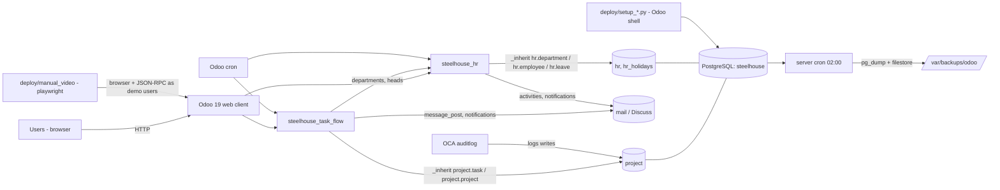

<!-- last-synced: 2026-11-25, commit: c56cf43 -->
# Architecture

## Components

| Component | Where | Responsibility |
|---|---|---|
| Odoo 19.0 Community | server, service `odoo` | `project`, `hr`, `hr_holidays`, `mail` (Discuss) - the base everything extends |
| `steelhouse_hr` | `addons/steelhouse_hr` | structure: several equal heads, org chart, hierarchy views; time off: delegations, approval order, balance per quarter, report |
| `steelhouse_task_flow` | `addons/steelhouse_task_flow` | task life cycle, review, sequences of steps, hold / resume, visibility, boards, home page, approvals app, reports, notifications |
| `steelhouse_project` | `addons/steelhouse_project` | earlier task module (stages, deadline extension requests) - not installed |
| OCA `auditlog` | `addons/oca/auditlog` | audit log of tasks, projects, users (rules loaded by `deploy/setup_auditlog.py`) |
| OCA `web_responsive` | `addons/oca/web_responsive` | apps home screen, mobile layout |
| Georgian translation | `i18n/ka/*.po` | standard modules' interface in Georgian (`deploy/apply_ka_translations.sh`) |
| Setup scripts | `deploy/setup_*.py` | one-off data: structure, automation rules, task properties, visibility list (Odoo shell) |
| Backup | `deploy/backup/` | nightly dump + filestore, monthly restore test (server cron) |
| Video manuals | `deploy/manual_video/` | playwright drives the live UI as demo users, ffmpeg writes mp4 |

## Data flow

| From | To | What | How |
|---|---|---|---|
| Web client (OWL widgets) | `project.task` | sequence tab, card lists, approvals, dashboard, reports | `orm.call` on model methods (`sh_chain_*`, `sh_card_list`, `sh_approval_*`) - no custom HTTP routes |
| `steelhouse_task_flow` | `steelhouse_hr` | department heads for write rights and escalation | `hr.department.sh_all_manager_user_ids` |
| Task changes | people | notifications | `message_post` with `partner_ids` (Discuss inbox); no e-mail (SMTP pending) |
| Odoo cron | tasks, time off | repeat, overdue, digest, personal columns, deputies, allocations, mandatory days | 7 `ir.cron` records (see SPEC) |
| Server | backup folder | database + filestore | `/usr/local/bin/steelhouse_backup.sh` |

No external systems are integrated.

## Extension points

| Core model | Extended in | What for |
|---|---|---|
| `project.task` | 32 classes in `steelhouse_task_flow/models/` (one topic per file) | stages, review, sequences, hold, visibility, cards, reports |
| `project.task.type` | `project_task_type.py` | `sh_kind` - the meaning of a stage |
| `project.project` | `project_project.py`, `task_hold.py`, `task_view_departments.py` | department boards, project hold |
| `res.users` | `task_visibility.py` | `sh_see_*` - whose tasks a user sees |
| `hr.department`, `hr.employee`, `hr.employee.public`, `hr.job` | `steelhouse_hr/models/` | several heads, structure manager, org chart |
| `hr.leave`, `hr.leave.allocation`, `hr.leave.type`, `hr.leave.mandatory.day` | `steelhouse_hr/models/` | approval order, delegations, balance, mandatory days |
| `mail.activity`, `mail.thread`, `mail.notification` | `steelhouse_hr/models/` | approval activities, notification channel |
| `ir.attachment` | `steelhouse_task_flow/models/task_log.py` | task log of attached / removed files |

Overridden entry points:
- `project.task.write` - stage rules, sequence lock, resume to "new", review checks (several files, chained by `super()`).
- `project.task.web_search_read` / `web_read_group` - steps hidden from boards (`task_card_lists.py`).
- `project.task._compute_state`, `is_blocked_by_dependences` - main task never waits; permission to start after a held step.
- `hr_org_chart` controller routes - `steelhouse_hr/controllers/org_chart.py`.
- Global record rules on `project.task` and `project.project` - `security/project_rules.xml`.

New models: `steelhouse.task.section`, `sh.task.flow.event`, wizards (`steelhouse.task.flow.wizard`, `steelhouse.task.final.wizard`, `steelhouse.task.template.wizard`, `steelhouse.project.hold.wizard`), `steelhouse.leave.delegation`, `steelhouse.leave.balance`, `sh.leave.report`.
